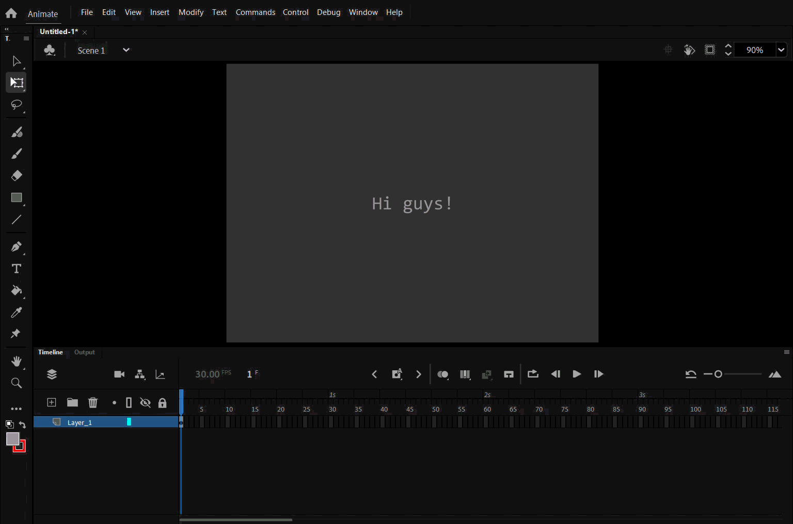

# Sawby's Flash JavaScript Commands
Collection of Flash JavaScript (JSFL) commands I made. Written and tested on Adobe Animate 2022. I'm still learning, so I can't guarantee anything great with these yet!

## Commands:
__Typewriter.jsfl__: Takes a text object and makes it add characters to itself to make a typewriter-like effect. Think of RPG games, for example!

That's it right now. I'll try to make a new command every day as practice!

##

For anybody concerned, nothing here was AI-assisted. I write them myself and use [this documentation](https://github.com/AdobeDocs/developers-animatesdk-docs) and other .jsfl files as reference. This README was also written from scratch.

🩷 - Sawby